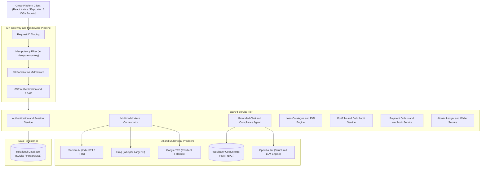

# Sahayak AI - Enterprise Financial Readiness Copilot and Digital Wallet

## Executive Summary

Sahayak AI is an enterprise financial readiness copilot and digital wallet platform designed for the Indian banking and credit ecosystem. The system bridges consumer financial literacy and institutional compliance by providing automated, source-grounded guidance on digital lending regulations, debt audit, and payment resolution.

Every informational response generated by the assistant is grounded directly in official regulatory directives issued by the Reserve Bank of India (RBI), the Insurance Regulatory and Development Authority of India (IRDAI), and the National Payments Corporation of India (NPCI). The platform integrates deterministic financial computation with multimodal conversational intelligence (text and voice), structured consent tracking, payment order orchestration, and simulated digital wallet ledger management.

---

## Architectural Overview

The application follows a decoupled client-server architecture:

- **Frontend Client**: Cross-platform application built with React Native (Expo SDK 58), React 19, TypeScript, and NativeBase. Supports iOS, Android, and Web with native gesture handling, real-time speech recognition, and an icon-only navigation interface.
- **Backend Service**: High-performance asynchronous REST API built with FastAPI (Python 3.11+), Pydantic v2 schemas, and SQLAlchemy ORM.
- **Data Layer**: Relational database supporting SQLite for local verification and PostgreSQL for production environments, structured around double-entry ledger principles.
- **AI and Multimodal Pipeline**: Retrieval-Augmented Generation (RAG) engine with vector and keyword search over verified regulatory corpora, backed by Sarvam AI (Indic STT and TTS), Groq Whisper, OpenRouter LLM inference, and resilient Google TTS fallback.
- **Middleware Infrastructure**: Request ID correlation, distributed idempotency locks (`X-Idempotency-Key`), and automated PII masking on outbound payloads.



---

## Core Capabilities

### 1. Regulatory-Grounded Financial Copilot
- **Documented Citations**: Responses regarding digital lending guidelines, Key Fact Statements (KFS), Annual Percentage Rates (APR), recovery agent codes of conduct, prepayment foreclosure charges, and insurance free-look terms provide verifiable clause citations.
- **Guardrail Enforcement**: Prevents hallucinated credit approvals. Clarifies lender-specific boundaries and directs users to official grievance redressal mechanisms (such as the RBI Integrated Ombudsman Scheme).
- **Multilingual Support**: Real-time localization in English, Hindi (हिन्दी), and Marathi (मराठी).

### 2. Real-Time Multimodal Voice-to-Voice Architecture
- **Speech-to-Text (STT)**: Direct streaming audio ingestion supporting WebM, MP4/AAC, OGG, and WAV containers. Automatic magic-byte inspection detects audio signatures and normalizes MIME types.
- **Indic Voice Synthesis (TTS)**: Indic vocalization powered by Sarvam AI (`simran_en_conversation`, `roopa_hi_conversational`, `ishita_mr_conversational`), coupled with an automated zero-dependency streaming fallback.
- **Client Speech Recognition**: Integrates browser-native Web Speech API for immediate live transcription feedback during active recording sessions.
- **Speech Lifecycle Management**: Hardware disconnect detection (`track.onmute`, `track.onended`), automatic silence detection (2.5-second inactivity timer), and a pause-to-send pipeline.

### 3. Loan Discovery and Catalogue Engine
- **Centralized Product Catalogue**: Standardized database schema storing interest rates (fixed vs. floating), processing fees, tenure options, and eligibility parameters across commercial banks and Non-Banking Financial Companies (NBFCs).
- **Deterministic EMI Engine**: Computes exact monthly amortizations and APR disclosures based on RBI KFS norms without relying on probabilistic model outputs.
- **Readiness Workflows**: Step-by-step guidance covering eligibility checks, document preflight analysis, and consent logging.

### 4. Loan Portfolio and Debt Audit Management
- **Centralized Debt Tracker**: Monitors active personal loans, credit card balances, vehicle loans, and home mortgages.
- **Audit Metrics**: Calculates debt-to-income (DTI) ratios, aggregate monthly liabilities, and payment health indicators.
- **Bill Schedule Integration**: Tracks scheduled due dates with reminder status.

### 5. Security, Privacy, and Financial Integrity
- **Double-Entry Ledger**: Demo wallet transactions are recorded as paired debit and credit entries with account balance validation.
- **Strict Idempotency**: Modifying requests requiring transactional safety accept a unique `X-Idempotency-Key` header, preventing duplicate debit or order execution.
- **PII Masking**: Outbound logging masks Aadhaar numbers, Permanent Account Numbers (PAN), Bank Account Numbers, and payment secrets.
- **Purpose-Audited Consent**: User consent events are timestamped and logged with explicit purpose descriptors.

---

## Repository Structure

```
├── .agents/                    # Agentic configuration and engineering skills
├── .maestro/                   # Maestro end-to-end mobile flow definitions
├── backend/                    # FastAPI backend service
│   ├── app/
│   │   ├── ai/                 # RAG indexing, prompt schemas, and provider clients
│   │   ├── api/                # REST API routers (auth, chat, voice, financial, etc.)
│   │   ├── middleware/         # Idempotency, request tracing, and PII masking
│   │   ├── models/             # SQLAlchemy ORM database models
│   │   ├── services/           # Core domain logic and financial calculators
│   │   ├── static/             # Static voice console and web demonstration assets
│   │   ├── config.py           # Application settings and environment validation
│   │   ├── database.py         # Database engine and connection lifecycle
│   │   └── main.py             # Application factory and middleware registration
│   ├── tests/                  # Pytest test suites (unit, integration, and E2E)
│   ├── requirements.txt        # Python package dependencies
│   └── .env.example            # Backend environment template
├── src/                        # React Native cross-platform application
│   ├── assets/                 # Brand assets and typography
│   ├── components/             # Reusable UI primitives and design tokens
│   ├── contexts/               # React Context providers (Auth, Language)
│   ├── navigation/             # App navigation stacks and tab navigator
│   ├── screens/                # Application screens (Chat, Journey, Portfolio, Wallet)
│   ├── services/               # API clients and HTTP abstractions
│   ├── types/                  # TypeScript interface definitions
│   └── utils/                  # Voice client, currency formatting, and audio decoders
├── __tests__/                  # Frontend Jest test suites
├── App.tsx                     # React Native root component
├── app.json                    # Expo project configuration
├── package.json                # Node.js dependencies and script definitions
└── tsconfig.json               # TypeScript compiler configuration
```

---

## Technology Stack

| Domain | Technology | Description |
| :--- | :--- | :--- |
| **Frontend Framework** | React Native 0.88.1 / Expo SDK 58 | Cross-platform mobile and web runtime |
| **Frontend Language** | TypeScript 6.0 / React 19.3 | Type-safe user interface development |
| **UI Components** | NativeBase 3.4 / Styled Components | Accessible design system and layout primitives |
| **Navigation** | React Navigation 7 | Native stack and icon-only bottom tab navigation |
| **Backend Framework** | FastAPI 0.115 / Uvicorn | Asynchronous Python web framework |
| **Validation Layer** | Pydantic v2.8 | Request and response schema enforcement |
| **ORM & Database** | SQLAlchemy / SQLite / PostgreSQL | Relational persistence and connection pooling |
| **AI Inference** | OpenRouter / Groq / Sarvam AI | Hybrid LLM, Whisper STT, and Indic TTS pipeline |
| **Test Frameworks** | Pytest, Jest, Maestro | Comprehensive backend, frontend, and mobile E2E tests |

---

## Prerequisites

- **Node.js**: Version 18.x or 20.x LTS
- **Python**: Version 3.11 or later
- **Package Managers**: `npm` (v9+) and `pip` (or `uv`)
- **Optional Native Toolchains**: Android Studio (for Android Emulator) or Xcode (for iOS Simulator on macOS)

---

## Environment Setup

### 1. Backend Environment Configuration

Create a `.env` file in the `backend/` directory based on the provided template:

```bash
cp backend/.env.example backend/.env
```

Key environment parameters:

| Variable | Default Value | Description |
| :--- | :--- | :--- |
| `ENVIRONMENT` | `development` | Runtime environment (`development`, `production`) |
| `PORT` | `8000` | Backend listener port |
| `DATABASE_URL` | `sqlite:///./sahayak.db` | SQLAlchemy connection string |
| `JWT_SECRET` | System Generated | Secret key used for signing session tokens |
| `ALLOWED_ORIGINS` | `http://localhost:8081,...` | Permitted CORS origins |
| `AI_EXTERNAL_PROCESSING_ENABLED` | `false` | Enables live external LLM processing |
| `SARVAM_API_KEY` | Optional | API key for Sarvam AI Indic STT and TTS |
| `GROQ_API_KEY` | Optional | API key for Groq Whisper transcription |
| `OPENROUTER_API_KEY` | Optional | API key for OpenRouter model access |
| `STRIPE_SECRET_KEY` | Optional | Stripe Secret Key for test order checkouts |

---

## Installation and Local Development

### 1. Backend Service Setup

Initialize a Python virtual environment and install the required packages:

```bash
# Create virtual environment
python3 -m venv backend/.venv

# Activate virtual environment
source backend/.venv/bin/activate

# Install dependencies
pip install -r backend/requirements.txt
```

Start the FastAPI application server:

```bash
cd backend
python -m uvicorn app.main:app --reload --host 0.0.0.0 --port 8000
```

The interactive OpenAPI documentation is available at:
`http://localhost:8000/docs`

### 2. Frontend Application Setup

In the root repository directory, install the Node.js dependencies:

```bash
npm install
```

Launch the development server:

```bash
# Start standard Expo bundler
npm run start

# Launch directly in web browser
npm run web

# Launch with port 8090
npm run web:8090
```

To run on native platforms:
- **Android**: `npm run android`
- **iOS**: `npm run ios`

---

## Testing and Quality Verification

The codebase maintains automated test coverage across backend API services, React Native components, and end-to-end user flows.

### 1. Backend Unit and Integration Tests

Execute the Pytest test suite with the Python path configured:

```bash
PYTHONPATH=backend pytest backend/tests/test_ai_voice_and_chat_e2e.py backend/tests/test_ai_voice_e2e_agent.py backend/tests/test_official_website_and_groq_voice.py
```

### 2. Frontend Unit and Component Tests

Execute Jest across all frontend unit and integration tests:

```bash
npm test -- --watchAll=false
```

### 3. End-to-End Mobile Automation (Maestro)

Execute automated device flows:

```bash
# Android Smoke Flow
npm run e2e:android

# iOS Smoke Flow
npm run e2e:ios
```

---

## Key API Endpoints

### Authentication and Identity
- `POST /api/auth/register`: Create a new user account with hashed password credentials.
- `POST /api/auth/login`: Authenticate and receive a JWT bearer token.
- `GET /api/auth/me`: Retrieve current authenticated user profile and permissions.

### Multimodal AI and Voice Services
- `POST /api/chat`: Grounded regulatory chat endpoint with RAG context injection.
- `POST /api/chat/voice/e2e`: End-to-end voice processing (accepts audio input, transcribes, queries RAG, returns text and synthesized speech).
- `POST /api/chat/voice/transcribe`: Dedicated audio transcription endpoint.
- `POST /api/chat/voice/speak`: Dedicated text-to-speech synthesis endpoint.

### Financial Products and Loan Audit
- `GET /api/financial/loans/catalogue`: Retrieve verified loan products with eligibility criteria.
- `POST /api/financial/loans/calculate-emi`: Deterministic EMI and amortization computation.
- `GET /api/loan-audit/portfolio`: Retrieve consolidated debt portfolio metrics.
- `POST /api/loan-audit/records`: Create or update tracked loan records.

### Payment Orders and Ledger
- `POST /api/payment-orders`: Initiate an idempotent payment order.
- `GET /api/payment-orders/{order_id}`: Query order status and fulfillment details.
- `POST /api/demo-wallet/transfer`: Atomic account-to-account transfer within the simulated ledger.

---

## Regulatory and Security Boundaries

1. **Informational Scope**: Sahayak AI provides financial educational guidance and readiness assistance. It does not act as a lender, NBFC, or credit rating agency. All loan terms, approvals, and disbursements remain subject to the sole discretion of the respective underwriting institution.
2. **Synthetic Data Isolation**: Demo wallet balances, mock loans, and test credits possess no monetary value and cannot be redeemed for fiat currency.
3. **Credit Score Boundaries**: The platform does not query or alter official credit bureau databases (CIBIL, Experian, Equifax, CRIF). Credit score indicators are illustrative estimates based solely on self-reported inputs.
4. **Data Protection**: Personal identifiers collected during readiness checks are processed in accordance with the Digital Personal Data Protection (DPDP) Act guidelines.

---

## License

This project is licensed under the MIT License. See the [LICENSE](LICENSE) file for complete details.

